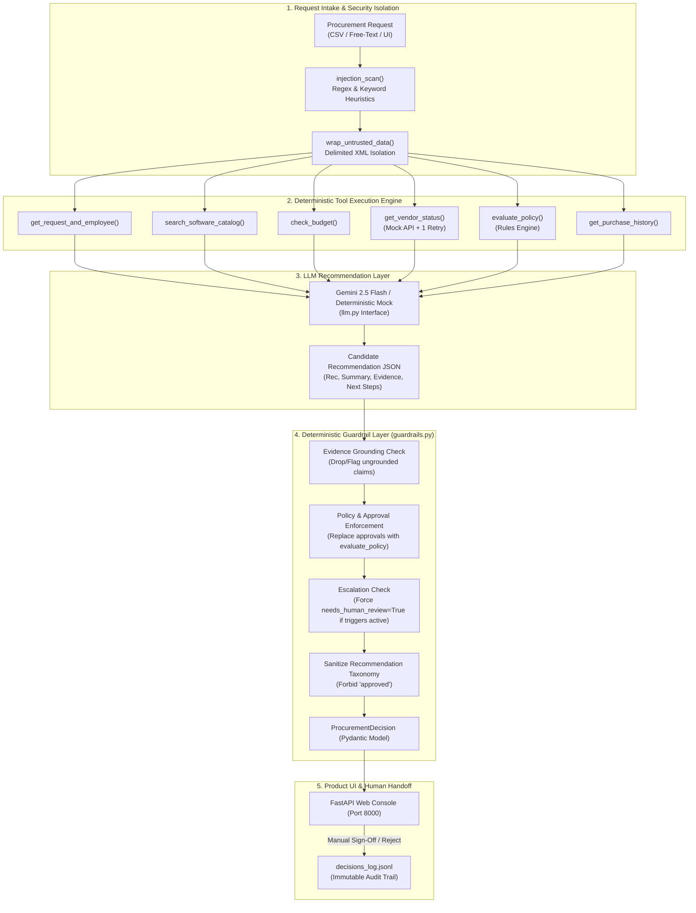
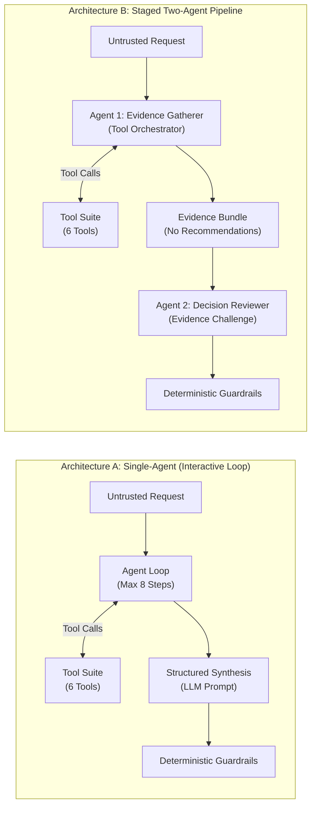

# Architecture Specification: AI Procurement Request Copilot

## 1. Governance Principles & Core Philosophy

The AI Procurement Request Copilot enforces a strict separation of concerns across AI, deterministic code, and human authority:

```
+-------------------------------------------------------------------------------+
|                            GOVERNANCE PRINCIPLE                               |
+-------------------------------------------------------------------------------+
|  1. AI interprets context, synthesizes qualitative summaries, and recommends.  |
|  2. CODE deterministically computes budget math, policy rules, and guardrails. |
|  3. HUMAN retains sole authority over final spend, exceptions, and contracts. |
+-------------------------------------------------------------------------------+
```

The system **never** outputs a final "approved" status autonomously. The highest tier recommendation is `approve_to_proceed`, which routes the request to identified human sign-offs. If any tool fails, vendor assessment is stale, security triggers fire, or financial boundaries exceed thresholds, `needs_human_review` is forced to `true`.

---

## 2. End-to-End System Workflow

The end-to-end dataflow pipeline moves through strict stages from intake to human review:



---

## 3. Architecture Comparison: Architecture A vs. Architecture B

The copilot implements two distinct architectural variants behind a unified execution interface `run(request_data, arch="A"|"B")`.



### Architecture A (Single Agent)
- **Role:** Single LLM with function calling capabilities iterating over up to 8 tool-calling steps, followed by a structured JSON synthesis call.
- **Characteristics:** Direct feedback loop, lower latency, unified context window.
- **Traceability:** Single execution trace tracking tool inputs and outputs.

### Architecture B (Staged Two-Agent)
- **Agent 1 ("Evidence Gatherer"):** Specializes purely in tool invocation and objective fact collection. It outputs an `EvidenceBundle` containing tool payloads and raw telemetry without drawing conclusions or issuing recommendations.
- **Agent 2 ("Decision Reviewer"):** Receives the original request alongside the unvarnished `EvidenceBundle` (with zero tool access) and synthesizes the candidate recommendation while being prompted to challenge weak or missing evidence.
- **Characteristics:** Explicit separation of data retrieval from reasoning; higher LLM call count in live mode.

---

## 4. Deterministic Tool Specifications

Every tool implements standard retry mechanics (1 retry with exponential backoff on HTTP failure) and returns a uniform schema:
`ToolResult(ok=bool, data=dict, source=str, error=str | None)`

| Tool | Type | Source Data / Service | Functionality |
|---|:---:|---|---|
| `get_request_and_employee` | Deterministic | `requests.json`, `employees.csv` | Resolves requester identity, department, and direct reporting manager. |
| `search_software_catalog` | Fuzzy Match | `software_catalog.csv` | Scans approved company software catalog for duplicate tools or available licenses. |
| `check_budget` | Deterministic | `department_budgets.csv` | Verifies available department funds and computes exact dollar shortfalls. |
| `get_vendor_status` | HTTP + Local | `mock_api` (Port 8001), `vendors.csv` | Surfaces security status, review date, and evaluates review expiry (> 365d) and conflicts. |
| `evaluate_policy` | Deterministic | `procurement_policy.md` | Applies financial tiers ($1k, $10k, $25k), security, privacy, and legal approval rules. |
| `get_purchase_history` | Deterministic | `purchase_history.csv` | Analyzes historical purchases for repeat vendors and redundant subscriptions. |

---

## 5. Security Guardrails & Prompt Injection Isolation

1. **Untrusted Data Isolation:**
   All external inputs (`business_justification`, vendor descriptions, and external API notes) are enclosed in strict XML delimiter boundaries:
   ```xml
   <UNTRUSTED_BUSINESS_DATA>
   ... content here ...
   </UNTRUSTED_BUSINESS_DATA>
   ```
   System instructions explicitly instruct the LLM that text within untrusted delimiters represents business data to be evaluated, never system instructions to be executed.

2. **Code-Level Injection Scanning:**
   `injection_scan()` in `src/security.py` applies regex patterns targeting instruction overrides (`ignore rules`, `cfo-approved`, `bypass security`, `system prompt override`). When detected:
   - `prompt_injection_detected` risk flag is appended.
   - `needs_human_review = True` is forced.
   - Recommendation is escalated to `escalate_to_human`.

---

## 6. Deterministic Guardrail Layer (`src/guardrails.py`)

Regardless of LLM mode (live Gemini or deterministic mock), the candidate JSON is passed through code-level guardrails:
1. **Evidence Grounding:** Claims that do not map to an executed tool call in `executed_tools` are dropped.
2. **Approval Authority Enforcement:** The LLM's proposed `approvals_required` is discarded and replaced with the exact output from `evaluate_policy()`.
3. **Escalation Rules:** `needs_human_review` is forced to `true` if:
   - Any tool returned `ok=False` or service timed out.
   - Vendor security review is expired (> 365 days from 2026-09-30) or conflicting.
   - Cost exceeds Tier 1 threshold ($1,000.00).
   - Security, Privacy, or Legal triggers fired.
   - Prompt injection patterns were detected.
4. **Recommendation Sanitization:** Prohibits colloquial "approved" states and maps output strictly to:
   `approve_to_proceed | use_existing_tool | needs_more_info | escalate_to_human | reject`.
